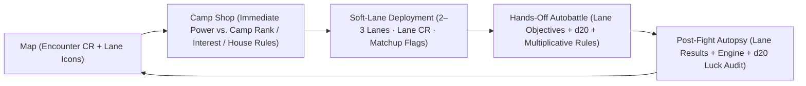

# Basements & Basilisks v0.24 — Core Loop Overhaul Implementation Plan

> **Archived v0.24 Plan** *(created prior to commit `b1bb2da`; superseded by [`v0.25_design_direction.md`](v0.25_design_direction.md)).*
> **Note on Naming:** During execution, the tentative **Guild Crests** name in this plan was finalized by the owner as **House Rules** (`src/04b-house-rules.js`) with a **6-slot cap** (`HOUSE_RULE_MAX = 6`). See [`v0.24_design_log.md`](v0.24_design_log.md) for what shipped and why.

---

## Goal Description

Transform the moment-to-moment loop of *Basements & Basilisks* so every decision in the **Map**, **Camp Shop**, and **Tactical Deployment** feels unmistakable, legible, and high-stakes—while preserving **100% of the 24 reworked heroes**, their 13 Class Keywords, 48 Specializations, 9 Epic Boons, 12 Multiclass Dips, 24 Opt-In Quests, 82 D&D Items, Cubed AC/SR math, 100% hands-off autobattling, and live d20 combat variance.

This overhaul unites four tightly interlocking pillars:
1. **Soft-Lane Battlefields & Redesigned Maps (`Breach & Flank`):** Redesign all 13 battle maps into 2–3 physical lanes with lane-specific enemies, visible win/loss objectives, and rear/mid crossover bridges so placement becomes a crisp, readable puzzle.
2. **Challenge Rating (`Party CR` vs. `Encounter CR` & Per-Lane Matchups):** Give players an honest, D&D-canonical measure of their team's power vs. upcoming map encounters and per-lane threats—eliminating blind betting and knowledge gaps.
3. **Exponential Difficulty Curve (*Balatro*-Style) + Shop-Offered Party Modifiers (*Guild Crests* → *House Rules*, Inspired by *Guildrun* Relics):** Steeply ramp enemy CR across Acts 1→3 so flat stats carry early while multiplicative party-wide engines (especially Class-Keyword triggers amplified by Multiclassing) are required to conquer Act 3.
4. **Immediate Power vs. Future Power Shop Economy:** Add **Camp Rank** upgrades, higher **Gold Interest**, and **Scaling Investment Items** alongside immediate flat-power offers so players constantly weigh *"survive now vs. compound for later"* using CR as their compass.

---

## Key Decisions Resolved Before Execution

1. **Modifier Name:** Chosen as **House Rules** (over *Guild Crests*, *Party Feats*, *Campaign Tomes*).
2. **Capacity:** Chosen as a capped **6-slot tray** (`HOUSE_RULE_MAX = 6`, with 50% refund sell/replace) to test whether a cap creates meaningful optimization tension.
3. **Hero Preservation Contract:** Zero hero kit rewrites — all 24 heroes in [`src/03-heroes.js`](../src/03-heroes.js) kept their exact stats, abilities, Specializations, Quests, Multiclass dips, and Epic Boons.

---

## Proposed Changes

### Pillar 1 — Soft-Lane Battlefields, Redesigned Maps & Lane Objectives

#### [MODIFY] [`src/01-geo.js`](../src/01-geo.js)
- Add lightweight lane helper functions operating on `MAP` and active `LANES` metadata:
  - `loadMap(rows, lanes)`: stores `LANES` (defaulting to a single full-width lane if omitted, preserving backwards compatibility with any custom map).
  - `laneOfCol(c, lanes)` and `laneOfUnit(u, lanes)`: returns lane index (`0`, `1`, or `2`) for any tile or unit (using footprint center for `2×2` Large units).
  - `laneDeployCells(laneIdx)`: returns all `DEPLOY` squares belonging to that lane, including optional `maxHeroes` constraint (e.g., `1` for narrow **Duel Choke** lanes).

#### [MODIFY] [`src/02-enemies.js`](../src/02-enemies.js)
- Redesign all **13 `BATTLE_MAPS`** across Acts 1–3 into structured **Soft-Lane** arenas:
  - **2-Lane Arenas (`10×10`)** — Left (`c: 0..3`), Divider (`c: 4..5` blocked on rows `2..6`, open rear/front crossovers at `r: 0..1` and `r: 7..9`), Right (`c: 6..9`):
    - Act 1: `triboar_road`, `tresendar_cellar`
    - Act 2: `frictionless_hall`, `shadow_crypt`
    - Act 3: `iron_citadel`
  - **3-Lane Arenas (`11×10`)** — Left (`c: 0..2`), Divider (`c: 3`, crossovers at `r: 0..1` and `r: 8..9`), Center (`c: 4..6`), Divider (`c: 7`, crossovers at `r: 0..1` and `r: 8..9`), Right (`c: 8..10`):
    - Act 1: `cragmaw_cave`, `thundertree_ruins`, `spider_temple`
    - Act 2: `boiling_bubble`, `inverted_ziggurat`
    - Act 3: `avernus_wastes`, `styx_crossing`, `throne_ninth`
  - Every lane is **3–4 tiles wide**, guaranteeing clean pathing for `2×2` Large units (Sir Dane, Pillar, Owlbear, Venomfang, Tiamat, Orcus) and side-by-side Aura / Bardic Inspiration pairings within a lane.
- Add canonical **`LANE_OBJ`** registry defining 6 readable lane win/loss conditions:
  - `breach` (**Main Breach**): Clear lane → surviving heroes gain **Flank Rush** (`+35%` move speed, `+20%` Haste for `5s`) as they cross over to assist adjacent lanes.
  - `ritual` (**Dark Ritual — 12s**): Enemy caster channels a dark ritual. *Win <12s:* Interrupt + `+2g` + 1s Stun to remaining foes. *Fail / Empty:* All enemies gain `+25%` Max HP Ward.
  - `loot` (**Supply Cart — 14s**): Guarded cache. *Win <14s:* Instant `+3g` (Act 1) / `+4g` (Act 2) / `+5g` (Act 3) + 1 free shop reroll credit. *Fail / Ignore:* Cart escapes (opportunity cost only).
  - `choke` (**Duel Choke — 1 Hero Max**): Narrow 1v1 sentinel/charger lane. *Win:* Party gains `+2 AC & +2 SR` for rest of fight. *Left Empty:* Enemy flankers gain **Ambush** (`+35%` damage for `5s` + Haste) as they loop into your rear.
  - `shrine` (**Battle Shrine**): Clear lane first → surviving allies gain **Advantage** on next cast + `+25` Charge.
  - `boss` (**Boss Throne**): Center boss lane; clearing side lanes weakens the Boss (`Exposed` for `6s`) and lets flankers surround.
- Update all **35 encounters in `ENC`** so enemy spawn coordinates `(c, r)` align cleanly inside their lanes and each encounter specifies intentional per-lane compositions.

#### [MODIFY] [`src/05-engine.js`](../src/05-engine.js)
- **Soft-Lane Targeting (`pickTarget`):** Initialize `b.lanes` in `newBattle()`, apply same-lane affinity while active foes remain in lane, and lift affinity on lane win so surviving heroes cross over to flank.
- **Lane Objective Ticker (`tickLanes`):** Track countdown timers on `ritual` (12s) and `loot` (14s) lanes; trigger `choke` uncontested ambush if 0 heroes deployed in a Choke lane.
- **Autopsy Telemetry:** Record per-lane outcomes, House Rule stacks/multipliers, `d20Log`, and `mitLost` (Physical blocked by AC / Magic blocked by SR).

#### [MODIFY] [`src/10-board.js`](../src/10-board.js)
- Render translucent lane tinting, floating **Lane Header Bars** with live CR badges/timers/flags, and `maxHeroes: 1` Duel Choke drag-swap validation.

---

### Pillar 2 — Challenge Rating (`Party CR` vs. `Encounter CR`) & Diagnostics

#### [MODIFY] [`src/06-adventure.js`](../src/06-adventure.js)
- **Deterministic Encounter CR (`calcEncounterCR`, `estimateNodeCR`):** Compute power directly from enemy HP/damage scaling, AC/SR EHP (`K=16`), boss/elite weights, waves, and hazards; pre-scout every combat node on the 9-row DAG.
- **Honest Live Party CR (`calcPartyCR`):** Compute `{ cr, offense, durability, engine }` from board heroes' live `heroStats()` multiplied by the active House Rules engine multiplier.
- **Per-Lane Matchup Evaluator (`evalLanes`):** Return per-lane `{ heroCR, enemyCR, verdict, flags[] }`.

#### [MODIFY] [`src/11-shell.js`](../src/11-shell.js)
- Persistent `Party CR` badge in Camp Shop, Map Header, and Combat HUD; Map Node CR badges; Post-Combat Autopsy with Lane Summary, House Rules contributions, AC/SR diagnostic tips, and d20 Luck Audit.

---

### Pillar 3 — Exponential Difficulty Curve & House Rules (Shop Party Modifiers)

#### [NEW] [`src/04b-house-rules.js`](../src/04b-house-rules.js) *(originally drafted as `04b-crests.js`)*
- 4 rarities (`Common 4g`, `Uncommon 6g`, `Rare 9g`, `Legendary 14g`), `HOUSE_RULE_MAX = 6`, and **36 permanent party-wide House Rules**:
  - **13 Class-Keyword Multiplicative Engines** (1 per canonical Class Keyword, supercharged by Multiclass Shrines).
  - **8 Composition, Lane & d20 Rules**.
  - **6 Economy & Future-Power Rules**.
  - **9 Legendary Capstone Engines** for Act 2–3 scaling.
- `houseRuleFit(ruleKey, run)` to badge matching rules in the Camp Shop (`★ Engine Match`) and `houseRuleEngineMult(run)` for Party CR.

#### [MODIFY] [`src/05-engine.js`](../src/05-engine.js) & [`src/06-adventure.js`](../src/06-adventure.js)
- Wire all 36 House Rules into `newBattle()`, `emitClassKw()`, `hit()`, `heal()`, `addWard()`, `castAbility()`, `gainGold()`, and `onLaneWon()`.
- Recalibrate `curveAt(d)` into a piecewise exponential 3-Act ramp and add 1-of-3 House Rule Drafts after Act Boss / Miniboss wins.

---

### Pillar 4 — Immediate vs. Future Power Camp Shop Economy

#### [MODIFY] [`src/04-items.js`](../src/04-items.js)
- Preserve all 82 existing items and add **6 `🌱 Scaling` Uncommon Investment Items** (`4g`, 1 per attribute to preserve exact 6-attribute parity → 88 total items) that gain `+1` permanent stack on every combat win while equipped.

#### [MODIFY] [`src/06-adventure.js`](../src/06-adventure.js), [`index.html`](../index.html), [`styles.css`](../styles.css), [`src/11-shell.js`](../src/11-shell.js)
- Add **Camp Rank (`I → IV`)** (`7g / 11g / 15g`, `-1g` discount per win) raising Gold Interest cap (`+5g → +12g`), unlocking Rare/Legendary House Rules & a 3rd rule slot, boosting Tier II/III Hero & Rare+ Item odds, and granting 1 free reroll per visit at Rank IV.
- Bump save schema to `v0.24` (`bb024.run`).

---

### Tooling, Calibration & Build Scripts

- **[NEW] [`tools/verify-v024.mjs`](../tools/verify-v024.mjs):** Headless invariants, Soft-Lane geometry audit, 36-House-Rule smoke test, CR correlation check, and 5-persona 3-Act calibration.
- **[MODIFY] [`tools/bundle.mjs`](../tools/bundle.mjs) & [`tools/test-e2e-chromium.mjs`](../tools/test-e2e-chromium.mjs):** Include `src/04b-house-rules.js` in the standalone bundle (`dist/Basements_&_Basilisks_0.24.html`) and extend Chromium E2E coverage to all v0.24 features.
